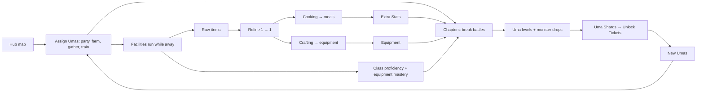

# Uma RPG — game design (draft v0.1)

> **Status: draft for owner review, 2026-10-10.** This is the first spec for uma-rpg as a standalone game. It will split
> into one doc per system once each system is approved.
>
> Every rule is tagged:
> **[Owner]** is the owner's direction and is decided.
> **[Proposed]** is Claude's recommendation for a gap; it stands unless the owner changes it.
> **[Open]** waits on the owner (see [open-questions.md](../open-questions.md)).
>
> Decisions are in [decisions.md](../decisions.md). The cross-game architecture is in uma-platform `docs/architecture.md`.

## 1. What the game is

A party RPG on the owner's iPhone. You collect Umas, level them through Octopath-style break battles across every
scenario, and run a big Hub map where Umas farm, gather, cook, craft and train while the app is closed.

**Pillars**

1. **Collect and level every Uma.** Collection and leveling are among the biggest parts of the game. **[Owner]**
2. **A living Hub.** Home is a huge map of facilities where Umas are assigned to passive work and training. **[Owner]**
3. **Break battles through every scenario.** The current battle engine, classes and chapter maps carry over from
   uma-racer. **[Proposed]**
4. **Make your own power.** Meals unlock Extra Stats, and materials become equipment. **[Owner]**
5. **Symmetry.** Each system mirrors another (farming ↔ gathering, cooking ↔ crafting, class proficiency ↔ equipment
   mastery), so learning one teaches the other. **[Owner]** (the "very symmetric" item families) **[Proposed]** (as a
   pillar)

**The loop**

## 2. Tiers

### 2.1 Tier = five scenarios, levels 1–50 **[Owner]**

A chapter is one scenario and covers ten levels. Tiers follow the original game's release order, read from master
data, so a newly released scenario slots in after a single import.

| Tier | Scenarios (chapter levels) |
|---|---|
| 1 | URA Finale (1–10), Unity Cup (11–20), Trackblazer (21–30), Our Grand Concert (31–40), Grand Masters (41–50) |
| 2 | Project L'Arc, U.A.F. Ready GO!, Great Food Festival, Run! Mecha Umamusume, The Twinkle Legends |
| 3 | Design Your Island, Yukoma Hot Springs, Beyond Dreams, Tracen Diner, *next released scenario* |

- **[Proposed]** Tier 3 opens with its four chapters. Its Tier Finale arrives with the fifth scenario.
- **[Proposed]** Each chapter keeps today's map shape, compressed from 12 levels to 10: Debut Lv1–3, Classic 4–6,
  Senior Year 7–9, Finals 10 (vanguard, then champion). A balance pass sets the exact node levels.

### 2.2 Tier worlds **[Owner]**

Each tier is its own world: its own Hub map, facilities, farm, item stock and roster view. Promotion moves one Uma
from tier N to tier N+1.

- The **old tier keeps everything**: the other Umas and their levels, facility levels, items and equipment. You can go
  back any time and keep playing it. In Tier 1 that's where you keep unlocking Umas.
- The **promoted Uma disappears from the old tier** and appears only in the new tier, at **Level 1**. Her progression
  starts over there.
- **Each tier gets different mechanics**, designed tier by tier. Tier 1 is described here. Tier 2 has no Uma unlocks;
  promotion is its only way in.

**What the promoted Uma carries [Proposed, confirm: Open]**

| Thing | In the new tier |
|---|---|
| Uma Level | Lv1 |
| Base stats | Keep growing by **lifetime level** (`50 × (tier − 1) + level`), as in uma-racer today, so a Tier 2 Lv1 Uma matches Tier 2 foes |
| Profession levels, class proficiency, equipment mastery, Extra Stats | Start over |
| Items and equipment | Stay in the old tier's world |

### 2.3 Promotion and the Tier Finale

- **[Owner]** Every tier ends with a big event: harder fights, or fights that make you switch parties around. In
  uma-racer this is Expeditions; uma-rpg needs its own idea.
- **[Proposed]** Promotion is manual and per Uma. It needs **Lv50** and **a win in the Tier Finale with her in the
  winning lineup**.
- **[Open]** The Tier Finale's form. Candidates:

  | Idea | How it plays | Cost |
  |---|---|---|
  | **Gauntlet** | Five back-to-back battles, one per scenario of the tier. Each needs a **different party** (25 Umas), and MP carries with few camps | Low: today's battle engine |
  | **Raid** | One huge boss with phases. Parties rotate in between phases, and each party keeps its damage and statuses | Medium |
  | **Siege** | A Fire Emblem/Wargroove-style grid map where three or four parties deploy as squads, and a break battle starts on contact | High: a new tactics layer, but it's the game's showcase for Phaser and pixel maps |

  Claude's recommendation: ship the **Gauntlet** first and keep the **Siege** as the long-term goal.

## 3. Collection (Tier 1 only) **[Owner]**

- A new game starts with **no Umas** and **15 Uma Unlock Tickets**.
- Each Uma earns **1 Uma Shard at Lv 10, 20, 30, 40 and 50**. **5 Shards = 1 Ticket**, so every Uma who reaches Lv50
  pays exactly one Ticket, and partial progress across many Umas adds up too.
- A Ticket unlocks any locked Uma of your choice.
- Tier 2 and later have no unlocks.

**[Open]** What a Ticket unlocks: an **outfit** (268 today) or a **character** (135)? The roster today is outfits, since
stats and aptitudes differ per outfit, and Claude recommends keeping outfits.

**Math (outfits):** unlocking all 268 takes 253 more Tickets, which means 253 Umas reaching Lv50 in Tier 1 (the last 15
unlocked never need to level). The chain never stalls as long as you keep leveling. It's a long-term collection by
design, so raising an Uma from 1 to 50 must get quicker with repeats:

- **[Proposed]** Keep today's EXP rule: fights above your level pay up to double, so new Umas catch up fast on chapters
  you've already cleared.
- **[Proposed]** Replays of cleared nodes stay fully rewarded.

## 4. An Uma's levels

Every Uma has several independent levels, all per tier.

| Level | Range | Raised by | Gives |
|---|---|---|---|
| **Uma Level** | 1–50 | Battles | Stats, skill points, Shards (Tier 1) |
| **Farming & Cooking** | 1–50 | Farm work and cooking | Higher crop grades and recipes; speed |
| **Gathering & Crafting** | 1–50 | Mining, woodcutting, gathering and crafting | Higher material grades and equipment; speed |
| **Class proficiency** | Ranks 1–6, per class | Class Hall | Skill depths in that class's trees |
| **Weapon mastery** | Ranks 1–10, per weapon type | Weapon Yard | Higher weapon grades |
| **Armor mastery** | Ranks 1–10, per armor type | Armor Yard | Higher armor grades |

- **[Owner]** Two profession verticals: Farming + Cooking, and Mining/Woodchopping/Gathering + Crafting.
- **[Open]** A third vertical, possibly as a later tier's new mechanic.
- **[Proposed]** Rank ranges (6 for classes, 10 for equipment), explained in §5 and §7.

### 4.1 Aptitudes set learning speed

**[Owner]** Running-style aptitude sets class learning speed, and distance aptitude sets equipment mastery speed.
**[Proposed]** Surface aptitude sets profession speed, so **every original aptitude has a job**:

| Aptitude group | Speeds up | Mapping |
|---|---|---|
| Running style (Front, Pace, Late, End) | Class proficiency **[Owner]** | Front → Brawler; Pace → Mage, Spell Blade; Late → Cleric; End → Summoner (today's mapping) |
| Distance (Sprint, Mile, Medium, Long) | Weapon and armor mastery **[Owner]** | Each weapon and armor type belongs to one distance (§7.2) |
| Surface (Turf, Dirt) | Professions **[Proposed]** | Turf → Farming & Cooking; Dirt → Gathering & Crafting |

**Time to finish, by aptitude grade.** **[Owner]** sets the ends: A takes 50% of the time, G takes 100%. **[Proposed]**
fills the grades between in even steps:

| A | B | C | D | E | F | G |
|---|---|---|---|---|---|---|
| 50% | 58% | 67% | 75% | 83% | 92% | 100% |

"A is 50% faster" is read as "A needs half the time", which is the same as earning progress twice as fast.

## 5. Classes **[Owner]**, with ranks **[Proposed]**

- **[Owner]** Every Uma can use every class and switch freely.
- **[Owner]** A class at rank 1 can't learn any skills.
- **[Owner]** Running-style aptitude sets how fast an Uma's class ranks up (§4.1).
- **[Proposed]** Each class keeps today's weapon set (the class decides what she wields), today's trees and today's
  battle role. The five classes are Brawler, Mage, Spell Blade, Cleric and Summoner.
- **[Proposed]** **Ranks 1–6.** Each rank above 1 opens one tree depth: rank 2 opens depth 1, and rank 6 opens depth 5
  (the capstones). These ranks replace today's depth gates at Uma Lv 1/10/20/30/40.
- **[Proposed]** **Skill points come from Uma Level, and every class tree gets the full amount.** Classes don't compete
  for points, so switching costs nothing; class rank is the real investment. Learned skills stay with their class.

## 6. Training facilities **[Owner]**, with details **[Proposed]**

Facilities where you slot **2 or 3 Umas** to raise something about the Uma herself:

| Facility | Each slot trains | Unlocks |
|---|---|---|
| **Class Hall** | One class's proficiency | Deeper skills in that class |
| **Weapon Yard** | One weapon type's mastery | Higher-grade weapons of that type |
| **Armor Yard** | One armor type's mastery | Higher-grade armor of that type |

- **[Proposed]** A facility starts with **2 slots** and gains a third with an upgrade (§9).
- **[Proposed]** Time to the next rank grows with the rank and is scaled by aptitude (§4.1). Training runs while the
  app is closed.
- **[Proposed] One activity at a time.** An Uma is fighting (in a party), working (farm or gathering site), training
  (facility) or idle. Parties are saved lineups, so a party with a working or training member can't start a fight until
  she's recalled. That's what makes allocation a real choice. **[Open]** Confirm.

## 7. Equipment **[Owner]**, with structure **[Proposed]**

**[Owner]** Equipment is a big new system that mirrors farming and cooking:

- gathering activities (mining, woodchopping, item gathering);
- simple crafting (raw → refined);
- equipment crafting.

Equipment should be very varied. Every Uma can equip anything, and distance aptitude sets how fast she masters it.

### 7.1 Slots and grades **[Proposed]**

- **Slots:** the class's weapons (one or two, as today), one **armor**, one **accessory**.
- **Ten grades per tier world**, matching the ten material grades (§8.2). Equipping a grade-k weapon or armor needs
  **mastery rank k** in its type. Crafting grade k needs **Gathering & Crafting Lv 5k − 4** (1, 6, 11 … 46).
  Accessories have no mastery gate.
- **Variety** comes from type × grade × variant: elemental infusions, stat leanings and special effects that interact
  with breaks, shields and Limit Breaks. The equipment catalog is its own design doc.

### 7.2 Types by distance **[Proposed, draft]**

Light gear belongs to Sprint and heavy gear to Long.

| Distance | Weapon types | Armor type |
|---|---|---|
| Sprint | Short Sword, Bow | Garb (light) |
| Mile | Spear, Axe | Leather |
| Medium | Mage Staff, Arcane Staff | Mail |
| Long | Greatsword, Cleric Staff, Summoner Tome | Plate (heavy) |

**[Proposed]** Heavier armor trades Speed for DEF.

### 7.3 Balance **[Owner]**

Equipment needs a rebalance. **[Proposed]** Foe stats add the **expected gear and Extra Stats for their level**, so a
party geared for its level feels like today's tuned difficulty, and an ungeared party feels harder.

## 8. Professions: gather → refine → make

### 8.1 Two mirrored verticals

| | Farming vertical | Gathering vertical |
|---|---|---|
| Uma level | Farming & Cooking 1–50 | Gathering & Crafting 1–50 |
| Aptitude **[Proposed]** | Turf | Dirt |
| Raw families **[Proposed]**, 10 grades each | Fruits, Vegetables, Grains, Herbs & Spices, Dairy & Eggs | Ores, Woods, Stones & Gems, Fibers, Monster Parts |
| Sites | Orchard, Garden, Fields, Herb Garden, Ranch | Mine, Forest, Quarry, Meadow; Monster Parts drop from battles |
| Refining, 1 → 1 **[Owner]** | Fruit → Preserve, Vegetable → Prepped Veg, Grain → Flour, Herb → Dried Herb, Milk/Egg → Butter/Custard | Ore → Ingot, Wood → Plank, Stone → Cut Gem, Fiber → Cloth, Part → Treated Hide |
| Making **[Owner]** | **Cooking:** meals for Extra Stats, varied recipes | **Crafting:** weapons, armor and accessories, very varied |
| Stations **[Proposed]** | Kitchen | Forge, Workshop, Loom, Jeweler |

**[Owner]** Raw ingredients are "Tier 0": a lot of variety with very symmetric types, like 10 fruits, 10 vegetables
and so on.

**[Owner]** Cooking is authored from scratch. uma-racer's last Farm version isn't the model.

**[Proposed]** Monster Parts drop from battles. That ties combat into crafting the way the Ranch ties animals into
cooking. The other nine families are passive sites.

### 8.2 Grades **[Proposed]**

- Every family has **10 grades**. Grade k unlocks at the matching profession **Lv 5k − 4** (1, 6, 11 … 46), the same
  ladder in every family.
- Raw and refined grades match (refining is 1 → 1).
- **Totals:** 100 raw, 100 refined, plus recipes. All item icons are original pixel art generated by script.

### 8.3 Cooking **[Proposed]**

- A recipe takes **2–4 ingredients from different families**, refined and sometimes raw. A meal's grade is its lowest
  ingredient grade.
- Recipes unlock by Farming & Cooking level and come in dish types (soups, breads, grills, salads, desserts, drinks,
  feasts), so every family stays useful.

### 8.4 Jobs **[Proposed]**

- Sites and stations run **timed jobs** that finish while the app is closed. Durations grow with grade.
- A finished job pays its item and profession XP to the Uma who worked it.
- Exact timers come from a pacing model in the balance pass.

## 9. Hub map **[Owner]**, with layout **[Proposed]**

**[Owner]** Home is a huge map that opens many passive facilities.

**[Proposed]**

- One map per tier world: a Phaser scene, scrollable and zoomable, built from original pixel tiles.
- Districts:
  - **Farmlands:** orchard, garden, fields, herb garden, ranch.
  - **Wilds:** mine, forest, quarry, meadow.
  - **Town:** kitchen, forge, workshop, loom, jeweler.
  - **Academy:** Class Hall, Weapon Yard, Armor Yard.
  - **The Gate:** chapters.
  - **The Tier Finale landmark.**
- Assigned Umas show as chibis working at their site. A badge marks finished jobs. Tapping a site opens a React sheet
  (assign, collect, upgrade).
- **Facility levels** are the tier world's own progression: materials from both verticals upgrade a facility for more
  slots and speed. These levels stay with the tier world (§2.2).

## 10. Extra Stats **[Owner]**, with structure **[Proposed]**

**[Owner]** An Uma eats cooked items to unlock Extra Stat slots. Unlocked slots are assigned freely, with a cap on how
many can be allocated. The stats are the RPG's own, not racing stats.

**[Proposed]**

- The stats are today's RPG combat stats: **HP, MP, ATK, M.ATK, DEF, M.DEF, Speed**.
- Each Uma has **10 slots per tier**. Slot k unlocks when she eats a **meal of grade k or better**, and its value grows
  with k.
- Assign each unlocked slot to any stat, and reassign freely outside a fight.
- **The cap:** at most **3 slots on the same stat**, so builds lean without dumping everything into one stat.
- **[Open]** If "a cap on how many I can allocate" meant a total that is lower than the number of unlocked slots, this
  changes to "unlock up to 10, assign up to N".

## 11. Difficulty **[Owner]**

- **[Owner]** The curve isn't steep. Today's regular, sub-boss and boss sets are a good base.
- **[Owner]** Scaling is linear between scenarios: foe stats and HP grow like Uma stats and skill damage do.
- **[Owner]** Scenarios differ by **flavor** (enemy distribution and types), not by difficulty. Details later.
- **[Owner]** The Tier Finale is where difficulty rises. Details later.
- **[Proposed]** Keep today's foe curve on lifetime level, `22 + 1.59 × (level − 1)` for the average stat, with the
  role, rank and shield rules from uma-racer's class doc, plus the gear and Extra Stats budget (§7.3).

## 12. Carried over from uma-racer's RPG **[Proposed]**

| Keep | Retire |
|---|---|
| Battle engine v5: breaks, shields, Limit Break, statuses, seeded replay | Inspiration tokens, Inventory/Convert for tokens, the Inspiration advance |
| Five classes, their trees, hands and weapon sets | Class choice by A running style (classes are now free) |
| Chapter maps, camps, carried MP, replays, Finals routes (re-cut to 10 levels) | 12-level chapters |
| Ten saved parties, roster and profile screens | Enrollment freezing an outfit; fixed class per Uma |
| The campaign simulation harness | Anything paid into uma-racer |

## 13. Next steps

1. The owner reviews this draft and answers [open-questions.md](../open-questions.md).
2. Split into per-system docs: tiers and collection, classes and mastery, equipment, professions and items, Extra
   Stats, Hub.
3. Item and recipe catalogs (names, families, grades) and the pacing model (timers, XP curves).
4. Phase 1 scaffold and the port of the battle engine.
