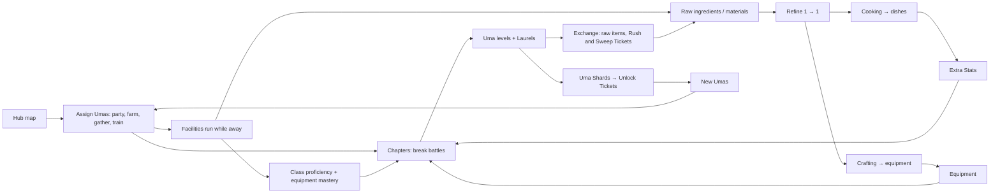

# Uma RPG — game design (draft v0.4)

> **Status: draft for owner review, 2026-10-10.** v0.2 folded in the owner's answers to Q1–Q5 (D14–D20). v0.3 adds the
> four-page Hub, the Learning District and the Sun-and-planets Extra Stats map (D21–D23). v0.4 adds Laurels and the
> Exchange, and gear that binds to its wearer (D27–D29). This is the
> first spec for uma-rpg as a standalone game. It will split into one doc per system once each system is approved.
>
> Every rule is tagged:
> **[Owner]** is the owner's direction and is decided.
> **[Proposed]** is Claude's recommendation for a gap; it stands unless the owner changes it.
> **[Open]** waits on the owner (see [open-questions.md](../open-questions.md)).
>
> Decisions are in [decisions.md](../decisions.md). The cross-game architecture is in uma-platform `docs/architecture.md`.

## 1. What the game is

A party RPG on the owner's iPhone. You collect Umas, level them through Octopath-style break battles across every
scenario, and run a big Hub map where Umas farm, gather, cook, craft and train while the app is closed.

**Pillars**

1. **Collect and level every Uma.** Collection and leveling are among the biggest parts of the game. **[Owner]**
2. **A living Hub.** Home is a huge map of facilities where Umas are assigned to passive work and training. **[Owner]**
3. **Break battles through every scenario.** The current battle engine, classes and chapter maps carry over from
   uma-racer. **[Proposed]**
4. **Make your own power.** Dishes unlock Extra Stats, and materials become equipment. Both matter equally. **[Owner]**
5. **Symmetry.** Each system mirrors another (farming ↔ gathering, cooking ↔ crafting, class proficiency ↔ equipment
   mastery), so learning one teaches the other. **[Owner]**

**The loop**

## 2. Tiers

### 2.1 Tier = five scenarios, levels 1–50 **[Owner]**

A chapter is one scenario and covers ten levels. Tiers follow the original game's release order, read from master
data, so a newly released scenario slots in after a single import.

| Tier | Scenarios (chapter levels) |
|---|---|
| 1 | URA Finale (1–10), Unity Cup (11–20), Trackblazer (21–30), Our Grand Concert (31–40), Grand Masters (41–50) |
| 2 | Project L'Arc, U.A.F. Ready GO!, Great Food Festival, Run! Mecha Umamusume, The Twinkle Legends |
| 3 | Design Your Island, Yukoma Hot Springs, Beyond Dreams, Tracen Diner, *next released scenario* |

- **[Proposed]** Tier 3 opens with its four chapters. Its Tier Finale arrives with the fifth scenario.
- **[Proposed]** Each chapter keeps today's map shape, compressed from 12 levels to 10: Debut Lv1–3, Classic 4–6,
  Senior Year 7–9, Finals 10 (vanguard, then champion). A balance pass sets the exact node levels.

### 2.2 Tier worlds **[Owner]**

Each tier is its own world: its own Hub map, facilities, farm, item stock and roster view. Promotion moves one Uma
from tier N to tier N+1.

- The **old tier keeps everything**: the other Umas and their levels, facility levels, items and equipment. You can go
  back any time and keep playing it. In Tier 1 that's where you keep unlocking Umas.
- The **promoted Uma disappears from the old tier** and appears only in the new tier, at **Level 1**. Her progression
  starts over there.
- **Each tier gets different mechanics**, designed tier by tier. Tier 1 is described here. Tier 2 has no Uma unlocks;
  promotion is its only way in.

**What the promoted Uma carries [Owner]** (D15)

| Thing | In the new tier |
|---|---|
| Uma Level | Lv1 |
| Base stats | Keep growing by **lifetime level** (`50 × (tier − 1) + level`), as in uma-racer today, so a Tier 2 Lv1 Uma matches Tier 2 foes |
| Profession levels, class proficiency, equipment mastery, Extra Stats | Start over |
| Items and equipment | Stay in the old tier's world |

### 2.3 Promotion and the Tier Finale

- **[Owner]** Every tier ends with a big event: harder fights, or fights that make you switch parties around. In
  uma-racer this is Expeditions; uma-rpg needs its own idea.
- **[Proposed]** Promotion is manual and per Uma. It needs **Lv50** and **a win in the Tier Finale with her in the
  winning lineup**.
- **[Open]** The Tier Finale's form. Candidates:

  | Idea | How it plays | Cost |
  |---|---|---|
  | **Gauntlet** | Five back-to-back battles, one per scenario of the tier. Each needs a **different party** (25 Umas), and MP carries with few camps | Low: today's battle engine |
  | **Raid** | One huge boss with phases. Parties rotate in between phases, and each party keeps its damage and statuses | Medium |
  | **Siege** | A Fire Emblem/Wargroove-style grid map where three or four parties deploy as squads, and a break battle starts on contact | High: a new tactics layer, but it's the game's showcase for Phaser and pixel maps |

  Claude's recommendation: ship the **Gauntlet** first and keep the **Siege** as the long-term goal.

## 3. Collection (Tier 1 only) **[Owner]**

- A new game starts with **no Umas** and **20 Uma Unlock Tickets** (D40).
- A Ticket unlocks one **outfit** of your choice (D14). There are 268 today.
- Each Uma earns **1 Uma Shard at Lv 10, 20, 30, 40 and 50**. **5 Shards = 1 Ticket**, so every Uma who reaches Lv50
  pays exactly one Ticket, and partial progress across many Umas adds up too.
- Tier 2 and later have no unlocks.

**Math:** unlocking all 268 takes 248 more Tickets, which means 248 Umas reaching Lv50 in Tier 1 (the last 20 unlocked
never need to level). The chain never stalls as long as you keep leveling. It's a long-term collection by design, so
raising an Uma from 1 to 50 must get quicker with repeats:

- **[Proposed]** Keep today's EXP rule: fights above your level pay up to double, so new Umas catch up fast on chapters
  you've already cleared.
- **[Proposed]** Replays of cleared nodes stay fully rewarded.
- **[Owner]** Sweep Tickets bought with Laurels (§11) complete cleared regular fights at once, so Umas who are behind
  can catch up without replaying every fight by hand.

## 4. An Uma's levels

Every Uma has several independent levels, all per tier.

| Level | Range | Raised by | Gives |
|---|---|---|---|
| **Uma Level** | 1–50 | Battles | Stats, skill points, Shards (Tier 1), Extra Stat capacity |
| **Farming & Cooking** | 1–50 | Farm sites, the Pantry and the Kitchen | Higher ingredient grades and dishes |
| **Gathering & Crafting** | 1–50 | Gathering sites, the Workbench and the Forge | Higher material grades and equipment |
| **Class proficiency** | Ranks 1–6, per class | Class halls | Skill depths in that class's trees |
| **Weapon mastery** | Ranks 1–10, per weapon type | Armories | Higher weapon grades |
| **Armor mastery** | Ranks 1–10, per armor type | Armories | Higher armor grades |

- **[Owner]** Two profession verticals, Farming + Cooking and Gathering + Crafting, that take **equal time** (§8.5).
- **[Open]** A third vertical, possibly as a later tier's new mechanic.
- **[Proposed]** Rank ranges (6 for classes, 10 for equipment), explained in §5 and §7.

### 4.1 Aptitudes set learning speed

**[Owner]** Running-style aptitude sets class learning speed, and distance aptitude sets equipment mastery speed.
**[Proposed]** Surface aptitude sets profession speed, so **every original aptitude has a job**:

| Aptitude group | Speeds up | Mapping |
|---|---|---|
| Running style (Front, Pace, Late, End) | Class proficiency **[Owner]** | Front → Brawler; Pace → Mage, Spell Blade; Late → Cleric; End → Summoner (today's mapping) |
| Distance (Sprint, Mile, Medium, Long) | Weapon and armor mastery **[Owner]** | Each weapon and armor type belongs to one distance (§7.2) |
| Surface (Turf, Dirt) | Professions **[Proposed]** | Turf → Farming & Cooking; Dirt → Gathering & Crafting |

**Time to finish, by aptitude grade.** **[Owner]** sets the ends: A takes 50% of the time, G takes 100%. **[Proposed]**
fills the grades between in even steps:

| A | B | C | D | E | F | G |
|---|---|---|---|---|---|---|
| 50% | 58% | 67% | 75% | 83% | 92% | 100% |

"A is 50% faster" is read as "A needs half the time", which is the same as earning progress twice as fast.

## 5. Classes **[Owner]**, with ranks **[Proposed]**

- **[Owner]** Every Uma can use every class and switch freely.
- **[Owner]** A class at rank 1 can't learn any skills.
- **[Owner]** Running-style aptitude sets how fast an Uma's class ranks up (§4.1).
- **[Proposed]** Each class keeps today's weapon set (the class decides what she wields), today's trees and today's
  battle role. The five classes are Brawler, Mage, Spell Blade, Cleric and Summoner.
- **[Proposed]** **Ranks 1–6.** Each rank above 1 opens one tree depth: rank 2 opens depth 1, and rank 6 opens depth 5
  (the capstones). These ranks replace today's depth gates at Uma Lv 1/10/20/30/40.
- **[Proposed]** **Skill points come from Uma Level, and every class tree gets the full amount.** Classes don't compete
  for points, so switching costs nothing; class rank is the real investment. Learned skills stay with their class.

## 6. Learning District and assignments

**[Owner]** Facilities where you slot **2 or 3 Umas** to raise something about the Uma herself. They fill the Hub's
Learning District (§9), with **several class hubs and several weapon hubs** (D21).

**[Proposed]** One hall per class and one armory per distance, with RPG names (D36):

| Facility | Each slot trains | Unlocks |
|---|---|---|
| **Brawler Dojo** | Brawler proficiency | Deeper Brawler skills |
| **Mage Tower** | Mage proficiency | Deeper Mage skills |
| **Spell Blade Salle** | Spell Blade proficiency | Deeper Spell Blade skills |
| **Cleric Chapel** | Cleric proficiency | Deeper Cleric skills |
| **Summoner Circle** | Summoner proficiency | Deeper Summoner skills |
| **Ranger's Lodge** | Short Sword, Bow or Garb mastery | Higher grades of that gear |
| **Lancer's Barracks** | Spear, Axe or Leather mastery | Higher grades of that gear |
| **Arcane Armory** | Mage Staff, Arcane Staff or Mail mastery | Higher grades of that gear |
| **Knight's Bastion** | Greatsword, Cleric Staff, Summoner Tome or Plate mastery | Higher grades of that gear |

- **[Proposed]** Each armory holds one distance's gear (§7.2), so the Uma's aptitude for that distance sets her speed
  anywhere in the building, and each class hall pairs with one running style (§4.1).
- **[Proposed]** A facility starts with **2 slots** and gains a third with an upgrade (§9). Each slot trains one class or
  one gear type.
- **[Proposed]** Time to the next rank grows with the rank and is scaled by aptitude (§4.1). Training runs while the
  app is closed.

**Assignments [Owner]** (D16)

- Umas stay in their party permanently.
- A party member who's busy at a facility, farm site or gathering site **shows greyed out** in her party.
- Umas outside any party can be assigned too.

**[Proposed]** A party with a greyed-out member can't start a fight. Her card offers **Recall**, which cancels her job:
its inputs come back and the unfinished output is lost.

## 7. Equipment **[Owner]**, with structure **[Proposed]**

**[Owner]** Equipment is a big new system that mirrors farming and cooking:

- gathering activities (mining, woodchopping, item gathering);
- simple crafting (raw → refined);
- equipment crafting.

Equipment should be very varied. Every Uma can equip anything, and distance aptitude sets how fast she masters it.

### 7.1 Slots, grades and variety **[Proposed]**

- **Slots:** the class's weapons (one or two, as today), one **armor**, one **accessory**.
- **Ten grades per tier world**, matching the ten item grades (§8.2). Equipping a grade-k weapon or armor needs
  **mastery rank k** in its type. Crafting grade k needs **Gathering & Crafting Lv 5k − 4** (1, 6, 11 … 46).
  Accessories have no mastery gate.
- **[Owner] Gear binds on equip** (D28). Once an Uma equips a piece, it's hers permanently and can never move to another
  Uma, so every fresh Uma crafts her own.
- **[Owner] No Uma Level gate** (D29). Mastery rank is the only requirement to equip.
- **[Proposed]** Bound pieces stay in **her locker**. She can swap freely among her own bound gear, so class switches
  stay free, but bound gear can't be traded, sold or moved. When she's promoted, her bound gear stays behind in the old
  tier world, like everything else (D15).
- **Variety** comes from type × grade × accent. The **main material** decides what can be made: ingots for blades and
  mail, planks for bows and staves, cloth for garb, leather for leather armor, cut gems and carvings for accessories. The
  **accent material** adds its family's effect (§8.2), exactly as a dish's star ingredient does.
- The equipment catalog is its own design doc.

### 7.2 Types by distance **[Proposed, draft]**

Light gear belongs to Sprint and heavy gear to Long.

| Distance | Weapon types | Armor type |
|---|---|---|
| Sprint | Short Sword, Bow | Garb (light) |
| Mile | Spear, Axe | Leather |
| Medium | Mage Staff, Arcane Staff | Mail |
| Long | Greatsword, Cleric Staff, Summoner Tome | Plate (heavy) |

**[Proposed]** Heavier armor trades Speed for DEF.

### 7.3 Balance **[Owner]**

Equipment needs a rebalance, and Claude does the balancing (D17).

- **[Proposed]** Extra Stats and equipment each add about the **same share of power** at every level, so neither
  cooking nor crafting can be skipped.
- **[Proposed]** Foe stats add the **expected gear and Extra Stats for their level**, so a party that's kept up with
  both feels like today's tuned difficulty, and a party that skipped them feels harder.

## 8. Professions: gather → refine → make

### 8.1 What the owner asked for **[Owner]** (D18–D20)

- **Depth.** Every produce type has **its own place on the Hub and its own effect**. No family of near-identical items
  (uma-racer's five milks and five fruits).
- **Three steps only:** raw → refined (1 → 1) → cooked or crafted. **No packaging step.**
- **Parity.** Cooking and crafting are mirror images. There are exactly as many material types as ingredient types,
  and an Uma spends her time equally between the two.
- Raw items are "Tier 0", with lots of variety and very symmetric types, like 10 fruits and 10 vegetables.
- Cooking recipes are varied, and the system is authored from scratch.

### 8.2 Families: one per effect, mirrored **[Proposed]**

Eight effects. Each effect has one farming family and one gathering family, and every family has its own site.

| Effect | Farming family | Site | Gathering family | Site |
|---|---|---|---|---|
| HP | Grains | Fields | Hides & Scales | Monster Den |
| MP | Fruits | Orchard | Essences | Ley Spring |
| ATK | Fish | Fishery | Ores | Mine |
| M.ATK | Herbs & Spices | Herb Garden | Crystals | Crystal Cavern |
| DEF | Vegetables | Vegetable Garden | Stones | Quarry |
| M.DEF | Mushrooms | Mushroom Cave | Fibers | Meadow |
| Speed | Sweets (honey, cane, cacao, maple…) | Sugar Grove | Woods | Forest |
| Limit Break charge | Nuts & Seeds | Nut Grove | Bones & Horns | Fossil Dig |

- **10 items per family, one per grade.** Grade k unlocks at profession **Lv 5k − 4** (1, 6, 11 … 46), the same ladder
  in every family on both sides.
- **Totals:** 80 raw ingredients and 80 raw materials, then 80 + 80 refined.
- Grades 1–8 run from common to rare. **Grades 9–10 are legendary** in every family and carry glints (D24).
- Example families:
  - Fruits: apple, pear, peach, plum, orange, grape, mango, pomegranate, starpeach, golden apple.
  - Ores: copper, tin, iron, silver, cobalt, gold, platinum, titanium, mythril, orichalcum.
- Battles pay **Laurels** (§11), not items. Laurels buy raw items of both sides at the Exchange.
- The full catalog is [items.md](items.md). Every icon is original pixel art drawn by uma-platform's `scripts/pixel-art` (D26).

### 8.3 Refining, 1 → 1 **[Owner]**

One refining station per side: the **Pantry** for ingredients and the **Workbench** for materials. **[Proposed]** Each
raw item has exactly one refined form of the same grade:

| Farming | Gathering |
|---|---|
| Grain → Flour | Hide → Leather |
| Fruit → Preserve | Essence → Infusion |
| Fish → Fillet | Ore → Ingot |
| Herb → Spice Blend | Crystal → Cut Gem |
| Vegetable → Prepped Vegetable | Stone → Block |
| Mushroom → Dried Mushroom | Fiber → Cloth |
| Sweet → Syrup or Chocolate | Wood → Plank |
| Nut → Paste or Oil | Bone → Carving |

### 8.4 Making **[Owner]**, with structure **[Proposed]**

| | Cooking (Kitchen) | Crafting (Forge) |
|---|---|---|
| Output | Dishes | Weapons, armor, accessories |
| Sets the effect | The **star** ingredient's family | The **accent** material's family |
| Sets the grade | The star ingredient | The main material |
| Other inputs | 1–3 side ingredients from other families | The main material (sets the type) plus 0–2 more |
| Variety | At least one dish per family per grade (80+), across dish types: soups, breads, grills, salads, desserts, drinks. Plus **Duo dishes** (two star families) and **Feasts** (all eight) for the Extra Stats bridges and Sun (§10) | Gear type × grade × accent effect |
| Feeds | Extra Stats (§10) | Equipment (§7) |

Side ingredients and extra materials are spread so **every family is in demand** on both sides.

### 8.5 Parity: equal time **[Proposed]**

1. The same number of families, items and unlock levels on both sides (§8.2).
2. For the same grade, a site job, a refining job and a making job take the same time and pay the same XP on both
   sides.
3. A dish and a piece of gear of the same grade use the same number of inputs.
4. Farming & Cooking and Gathering & Crafting share one XP curve, so maxing either takes the same time.
5. Extra Stats and equipment add about the same share of power (§7.3).

### 8.6 Jobs **[Proposed]**

- Sites and stations run **timed jobs** that finish while the app is closed. Durations grow with grade.
- A finished job pays its item and profession XP to the Uma who worked it.
- Exact timers come from a pacing model in the balance pass.

## 9. Hub **[Owner]**, with layout **[Proposed]**

**[Owner]** (D21) Home is the Hub: **four pages you can swap between freely**, each one a big map.

| Page | Places |
|---|---|
| **Farmlands** | The 8 farming sites, the Pantry and the Kitchen |
| **Wilds** | The 8 gathering sites, the Workbench and the Forge |
| **Learning District** | The 5 class halls and the 4 armories (§6) |
| **Town** | Stable (roster), Party Hall (parties), Scenario Gate (chapters), Warehouse (inventory), Exchange (Laurels), Observatory (Extra Stats), the Tier Finale landmark |

**[Owner]** (D22) Each place shows **tiny icons of the Umas assigned to it**. Tapping a place opens a **side overlay**
previewing those Umas.

**[Proposed]**

- Both at once: face icons with a progress ring always sit on the map, and the overlay shows larger portraits, job
  progress and the actions (Collect, Assign, Recall, Upgrade).
- Farmlands and Wilds mirror each other, site for site.
- Pages switch with a bottom tab bar or a sideways swipe. A badge on a tab counts finished jobs on that page.
- Each page is a Phaser scene you can scroll and zoom, built from original pixel tiles. Overlays are React.
- One Hub per tier world.
- **Facility levels** are the tier world's own progression: materials from both sides upgrade a facility for more
  slots and speed. These levels stay with the tier world (§2.2).

## 10. Extra Stats: the Sun and its planets **[Owner]**, with structure **[Proposed]**

**[Owner]** (D17, D23) An Uma eats dishes to unlock Extra Stat nodes and activates at most N of them. Increments are
**small** and there are **many slots**, for variety in builds, on the model of uma-racer's Sun-and-planets map. Claude
sets the numbers.

**[Proposed] One map per Uma per tier, with 100 nodes:**

| Part | Nodes | Each node gives | Unlocked by eating |
|---|---|---|---|
| **8 planets**, one per effect, in a ring | 10 moons each: 80 | +1 point of that effect | A dish starring that effect's family, of grade ≥ the moon's number |
| **8 bridges** between neighboring planets | 2 per pair: 16 | +½ point to each effect of the pair | A **Duo dish** starring both families (grade ≥ 3, then ≥ 7) |
| **The Sun** at the center | 4 | +⅛ point to all eight effects | A **Feast** cooked from all eight families (grade ≥ 4, 6, 8, then 10) |

- **Ring order:** HP – DEF – M.DEF – MP – M.ATK – ATK – Speed – Limit Break charge, then back to HP. Bridges pair stats
  that build together: HP + DEF, MP + M.ATK, ATK + Speed.
- **Every node is worth one point in total.** A point is a small fixed share of the stat, set in the balance pass
  together with equipment (§7.3).
- **One dish unlocks one node** and is eaten. Unlocked nodes stay for the tier.
- **Active nodes: N = 5 + ⌊Uma Level / 2⌋**, so 5 at Lv1 and 30 at Lv50. Swap them freely outside a fight. With 100
  nodes and 30 active, a build can stack one effect (its 10 moons plus both bridges), spread across everything with
  the Sun, or land anywhere between.
- The map opens from the Observatory in Town and from the Uma's profile.

## 11. Laurels and the Exchange **[Owner]**, with details **[Proposed]**

**[Owner]** (D27) Battles drop **Laurels**, a global currency spent at the **Exchange** in Town. The more you play, the
more you choose which single area to push. Laurels buy:

| Buy | Does | Rules **[Proposed]** |
|---|---|---|
| **Raw items** | Any raw ingredient or material | The soft scenario link: reaching a chapter stocks its grade pair (URA Finale grades 1–2, Unity Cup 3–4, Trackblazer 5–6, Our Grand Concert 7–8, Grand Masters 9–10). The price rises with grade. Producing items stays gated only by profession level |
| **Rush Ticket** | Finishes one running job at once | Farm jobs only: Farmlands and Wilds sites, the Pantry, Kitchen, Workbench and Forge. Not Learning District training, where time stays the gate |
| **Sweep Ticket** | Completes one cleared **regular** fight at once | Pays the fight's EXP (and so Shards), but **no Laurels**, so Laurels can't loop into more Laurels. Sub-bosses, champions and the Tier Finale must be fought |

**[Proposed]**

- Every win pays Laurels, replays included, scaled by the fight's level and kind (regular < sub-boss < champion).
- One wallet per tier world, like the rest of a tier's stock (§2.2).
- Prices and payouts come from the pacing model in the balance pass.

## 12. Difficulty **[Owner]**

- **[Owner]** The curve isn't steep. Today's regular, sub-boss and boss sets are a good base.
- **[Owner]** Scaling is linear between scenarios: foe stats and HP grow like Uma stats and skill damage do.
- **[Owner]** Scenarios differ by **flavor** (enemy distribution and types), not by difficulty. Details later.
- **[Owner]** The Tier Finale is where difficulty rises. Details later.
- **[Proposed]** Keep today's foe curve on lifetime level, `22 + 1.59 × (level − 1)` for the average stat, with the
  role, rank and shield rules from uma-racer's class doc, plus the gear and Extra Stats budget (§7.3).

## 13. Carried over from uma-racer's RPG **[Proposed]**

| Keep | Retire |
|---|---|
| Battle engine v5: breaks, shields, Limit Break, statuses, seeded replay | Inspiration tokens, Inventory/Convert for tokens, the Inspiration advance |
| Five classes, their trees, hands and weapon sets | Class choice by A running style (classes are now free) |
| Chapter maps, camps, carried MP, replays, Finals routes (re-cut to 10 levels) | 12-level chapters |
| Saved parties (twenty now, D41), roster and profile screens | Enrollment freezing an outfit; fixed class per Uma |
| The campaign simulation harness | Anything paid into uma-racer |

## 14. Next steps

The build order is in [plan.md](../plan.md). Design work still to do:

1. The owner reviews v0.2.
2. Split into per-system docs: tiers and collection, classes and mastery, equipment, professions and items, Extra
   Stats, Hub.
3. Catalogs: raw and refined items are drafted ([items.md](items.md)); dishes and gear are next. Then the pacing model:
   timers, XP curves, node and gear values, Laurel payouts and Exchange prices.
4. Icons for every raw and refined item (in progress in uma-platform `scripts/pixel-art`).
5. Phase 1 scaffold and the port of the battle engine.
